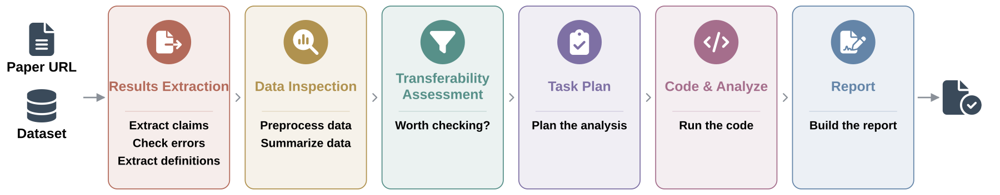

<div align="center">

<picture>
  <source media="(prefers-color-scheme: dark)" srcset="assets/smart_logo_dark.svg">
  
</picture>

<h3>20 agents</h3>

<p><strong>Test whether a published discovery holds in your data.</strong></p>

<p>SMART reads a paper, works out which of its claims your single-cell dataset can test,
runs those analyses, and returns a report of which ones held.</p>

[](https://www.biorxiv.org/)
[](https://cancer-wiki.github.io/SMART/)
[](https://cancer-wiki.org)
[](https://cancer-wiki.github.io/SMART/example-report/)
[](LICENSE)



</div>

---

## What you'd use it for

<p align="center"><b>Every biologist is a CEO.</b> SMART is the staff you could never hire.</p>

<table>
<tr>
<td width="50%" valign="top">


**Is this paper worth reading closely?**

Before you spend an afternoon on it, SMART does the first pass: reads the paper, tests its claims against your own data, and hands you a report end to end.

</td>
<td width="50%" valign="top">


**Did we overlook something already published?**

Somewhere in another cancer's literature is a result that would work in yours. It has sat there for years, cited but never tested, because nobody in either field had a reason to look. SMART looks.

</td>
</tr>
<tr>
<td width="50%" valign="top">


**My cancer barely has a literature.**

SMART brings the well-studied cancers in as outside expertise, testing their findings against your data so a small field can draw on a large one.

</td>
<td width="50%" valign="top">


**What is my data telling me?**

Every paper you test becomes a lens on your own dataset. Claims that fail, claims that arrive by another route, and signals no paper reported: SMART picks them out and writes them up.

</td>
</tr>
</table>

---

## Quick Start

> [!NOTE]
> SMART runs on the [Claude Code CLI](https://docs.anthropic.com/en/docs/claude-code). Agents execute on Claude Opus.

### 1 · Install

Agents are installed into `~/.claude/agents/`, where the Claude Code CLI picks them up.

```bash
git clone https://github.com/cancer-wiki/SMART.git
cd SMART
bash install.sh            # 20 agents + reference files
bash install_packages.sh   # R and Python dependencies
```

<!-- TODO: install_packages.sh does not exist yet. Repo ships install_R_packages.R (R only). -->

### 2 · Example case

Run the bundled example to check the installation end to end.

```bash
bash setup_case.sh https://pubmed.ncbi.nlm.nih.gov/PLACEHOLDER/ examples/demo_data.rds demo_case
cd demo_case
bash single_case.sh
```

Open `Outputs/final_report_revised.html` when it finishes. Takes roughly **PLACEHOLDER** on a laptop.

> [!TIP]
> Don't want to wait? [Read a finished report](https://cancer-wiki.github.io/SMART/example-report/) first.

<!-- TODO: needs a demo paper + small public dataset, and a real runtime figure. -->

### 3 · Run on your own

Point the setup script at any PubMed URL and any single-cell dataset. It fetches the paper, links your data into place, and lays out the folders the pipeline expects.

```bash
bash setup_case.sh <pubmed-url> <path/to/your_data.rds> my_case
cd my_case
bash single_case.sh
```

<!-- TODO: setup_case.sh does not exist yet. -->

| What you get | |
|---|---|
| `Outputs/final_report_revised.html` | **The report.** Self-contained, opens in any browser. Start here. |
| `Outputs/summary.txt` | The verified findings and claims extracted from the paper. |
| `Outputs/plots/` · `results/` | Every figure and statistical table generated. |
| `Outputs/analysis.R` *or* `analysis.py` | The exact code that was run. Re-runnable on its own. |
| `Working/` | Drafts, verification checks, definitions and plans. The full audit trail. |

> [!TIP]
> Running one paper against many datasets, or many papers against one dataset? See [Batch running](https://cancer-wiki.github.io/SMART/batch/).

## Documentation

Complete documentation at **[cancer-wiki.github.io/SMART](https://cancer-wiki.github.io/SMART/)**.

| | |
|---|---|
| [Quick start](https://cancer-wiki.github.io/SMART/quickstart/) | Install, example case, your own data |
| [Example reports](https://cancer-wiki.github.io/SMART/example-report/) | Complete reports from real runs, and how to read one |
| [Pipeline](https://cancer-wiki.github.io/SMART/pipeline/) | The six modules and what each decides |
| [Case folders](https://cancer-wiki.github.io/SMART/cases/) | Layout, inputs, outputs, resetting a case |
| [Batch running](https://cancer-wiki.github.io/SMART/batch/) | Many papers, many datasets, in parallel |
| [Transferability scores](https://cancer-wiki.github.io/SMART/scores/) | How High to Low are assigned |
| [Agent reference](https://cancer-wiki.github.io/SMART/agents/) | All 20 agents, what each one does |

## Citation

<!-- TODO: fill in once the preprint is posted. -->

```bibtex
@article{cheng2026smart,
  title   = {A multi-agent AI framework for Cross-Cancer Discovery Transfer},
  author  = {Cheng, Lingxin and Shireman, Jack and Gogate, Akash and
             Kendziorski, Christina},
  journal = {PLACEHOLDER},
  year    = {2026}
}
```

## License

[MIT](LICENSE)
