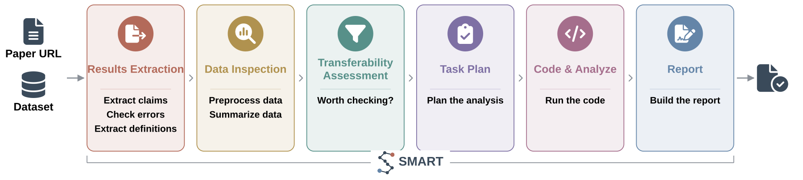

---
hide:
  - navigation
---

# SMART

**Test whether a published discovery holds in your data.**

SMART reads a paper, works out which of its claims your single-cell dataset can test, runs those
analyses, and returns a report of which ones held.

!!! note
    SMART runs on the [Claude Code CLI](https://docs.anthropic.com/en/docs/claude-code).
    Agents execute on Claude Opus.

## The idea

A paper's mechanism is a chain of claims. Tested whole against a dataset it never came from, it
usually fails on some link or other. Tested claim by claim, much of it carries over, and the parts
that do not tell you where the two settings genuinely differ.

SMART takes the mechanism apart, tests each claim separately against your data, and reports each
verdict with the figures and statistics behind it. Claims the paper never made can surface too.

## Where to go

-   **[Quick start](quickstart.md)**

    Install, run the example, then run it on your own data.

-   **[Example reports](example-report.md)**

    Read a complete report before running anything.

-   **[Pipeline](pipeline.md)**

    The six modules, the 20 agents, and what each one decides.

-   **[Case folders](cases.md)**

    What goes in, what comes out, and how to reset a run.

-   **[Batch running](batch.md)**

    Many papers against many datasets, in parallel.

-   **[Transferability scores](scores.md)**

    How High, Middle-High, Middle-Low and Low are assigned.

-   **[Agent reference](agents.md)**

    Every agent, and the job it does.

## Related

- **[cancer-wiki.org](https://cancer-wiki.org)** — the cross-cancer map SMART produced, released for glioblastoma
